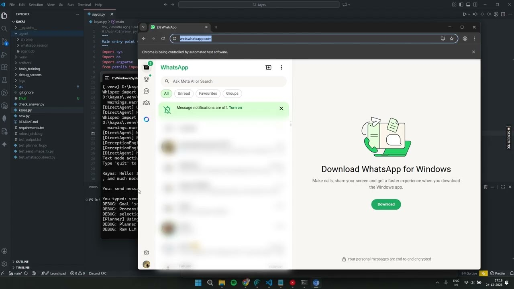

# Kayas AI Assistant

A Windows desktop agent I started in 2024 after a diploma chatbot and a long JARVIS itch. It lives on the machine: CLI, optional GUI, voice, and a set of executors that can drive native UI, a browser, or a few APIs.

The 32B model does not run on the laptop. Reasoning goes to a remote **Qwen3-32B-AWQ** (usually vLLM behind an ngrok tunnel from a Kaggle GPU) or Groq, depending on what is configured. Desktop clicks stay local.

**Walkthrough:** [YouTube](https://youtu.be/nnDcUl4WiPE) · [video file](https://github.com/user-attachments/assets/84f3ddf8-f055-472e-9134-be1e9cbe1cfa)



This is personal software, still in motion. Automation quality depends on the target app, screen state, and Windows permissions. It is not a finished product.

## What it actually does

- ReAct-style loop: think, emit a tool call, run it, continue
- Desktop: pywinauto first, then OpenCV template match, then Tesseract if the control tree is useless
- Voice: wake-word via a small Whisper, STT, Edge TTS. Whisper often hears “Kayas” as “guys” — that mapping is intentional
- Memory: SQLite history plus optional Chroma search
- Extra surfaces: `index.html` local GUI, system tray, `--cognitive` loop (experimental)

Executors in `src/executors/` cover WhatsApp Web, browser/Playwright, Explorer, Spotify, GitHub, Slack, calendar, and more. Treat those as working drafts, not “complete integrations.”

## Layout

```
kayas.py              CLI / voice / GUI entry
kayas_cognitive.py    older cognitive entry
index.html            local GUI
src/agent/            LLM clients, planner, safety
src/executors/        desktop, browser, apps
src/voice/
src/memory/
src/server/
brain_training/       LoRA notes and tokenizer bits
demo/                 recorded walkthrough
```

## Run

Windows 10/11, Python 3.10+, [Tesseract](https://github.com/UB-Mannheim/tesseract/wiki), Chrome if you want Playwright.

```bash
git clone https://github.com/kayas881/kayas_Assistant.git
cd kayas_Assistant
python -m venv .venv
.venv\Scripts\activate
pip install -r requirements.txt
playwright install chromium
```

`.env` (do not commit it):

```
VLLM_BASE_URL=
VLLM_MODEL=Qwen/Qwen3-32B-AWQ
GROQ_API_KEY=
```

```bash
python kayas.py                 # CLI, voice on if deps work
python kayas.py --no-voice      # text only
python kayas.py --continuous    # keep listening
python kayas.py --gui
python kayas.py --cognitive     # experimental
```

Related: [kayas-browser-agent](https://github.com/kayas881/kayas-browser-agent).
